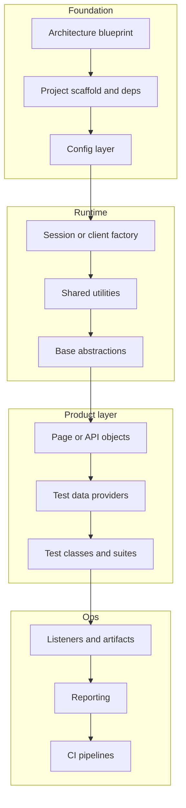

# Reusable Framework Skeleton Plan

Use this as the default mental model whenever you plan a framework (UI, API, mobile, or hybrid). This repo’s [ConfigReader.java](src/main/java/com/automation/config/ConfigReader.java) and [ARCHITECTURE.md](docs/ARCHITECTURE.md) are the concrete Selenium + TestNG reference; the layers stay the same even when tools change.

## Core idea

Build **infrastructure first, product tests second**. A framework is a stack of thin, single-responsibility layers with clear contracts. Tests should only depend on the top of that stack—not on browsers, HTTP clients, or raw config files.



## Layer checklist (always plan these)

| Layer | Purpose | This repo example | Swap for other stacks |
|-------|---------|-------------------|------------------------|
| **Blueprint** | Scope, suites, decisions, quality rules | [docs/ARCHITECTURE.md](docs/ARCHITECTURE.md) | Same for any project |
| **Scaffold** | Build tool, packages, resources | [pom.xml](pom.xml), `com.automation.*` | Gradle, npm, pytest layout |
| **Config** | Externalize env knobs; typed accessors | [ConfigReader.java](src/main/java/com/automation/config/ConfigReader.java) + `config.properties` | `.env`, YAML, Spring `@Configuration` |
| **Session / client** | Create, isolate, tear down runtime | [DriverFactory.java](src/main/java/com/automation/driver/DriverFactory.java) (`ThreadLocal`) | `ApiClient`, `AppiumDriver`, DB connection |
| **Utilities** | Cross-cutting helpers only | `WaitUtils`, `ScreenshotUtils` | Retry, JSON, auth token helpers |
| **Base abstraction** | Shared actions; no business asserts | [BasePage.java](src/main/java/com/automation/pages/BasePage.java), [BaseTest.java](src/test/java/com/automation/base/BaseTest.java) | `BaseApi`, `BaseScreen` |
| **Domain objects** | One screen/resource = one class | `LoginPage`, `CartPage`, … | Endpoint clients, screen objects |
| **Tests** | Arrange → act → assert outcomes | `LoginTests`, suites | Same |
| **Data** | Parameterized / external inputs | `LoginDataProvider` | CSV, JSON, factories |
| **Listeners / artifacts** | Failure hooks, retries | `TestListener`, `RetryAnalyzer` | pytest hooks, JUnit extensions |
| **Suites + CI** | Smoke vs regression; runnable in minutes | `testng-*.xml`, planned `ci.yml` | GitHub Actions, Jenkins |

## Design decisions to lock early (before coding)

Decide once and document in the blueprint:

1. **Pattern** — POM / Screenplay / API client modules (this repo: POM)
2. **Sync strategy** — explicit waits vs sleeps (this repo: explicit only; `implicitWait=0`)
3. **Concurrency model** — ThreadLocal / isolated clients (never shared static session across threads)
4. **Config contract** — keys, defaults, override via system props/env
5. **Where assertions live** — tests own expectations; objects expose state/actions
6. **Reporting + failure artifacts** — one tool; screenshot/log on fail
7. **Suite split** — smoke (every PR) vs regression (nightly)
8. **Secrets policy** — no real secrets in repo; demo creds only in data providers if public AUT

## Phased build order (reuse for any project)

Do not skip phases. Each phase has an exit criterion.

| Phase | Deliverable | Exit criterion |
|-------|-------------|----------------|
| **A — Blueprint** | Architecture doc: purpose, scope, page/API map, quality rules, roadmap | Team agrees on contract |
| **B — Scaffold** | Packages, build file, empty resources, config file skeleton | Project compiles / installs |
| **C — Config + session + base** | ConfigReader-style loader, factory, BaseTest/BasePage, one smoke open/quit | Runtime starts and cleans up |
| **D — Domain objects** | One class per screen/resource; locators/actions only | Happy-path flow callable from a scratch test |
| **E — Tests + suites** | Smoke + regression XMLs/markers; assertions in tests | Maven/npm/`pytest` green for smoke |
| **F — Hardening** | Parallel, reporting, retry policy, failure artifacts | Parallel smoke + report artifact |
| **G — CI** | Pipeline runs smoke on PR | Badge / green check |
| **H — Docs polish** | README: architecture summary + how to run in ~15 minutes | Newcomer can run without help |

**ConfigReader as the Phase C archetype:** load once (static/`Properties`), fail fast if missing, private constructor, typed getters (`getBrowser()`, `getBaseUrl()`, timeouts)—not raw string keys scattered in tests.

## Package skeleton template

```text
{project}/
├── docs/ARCHITECTURE.md
├── {build file}
├── src/main/.../{org}/
│   ├── config/          # ConfigReader (or equivalent)
│   ├── driver|client/   # Factory + isolation
│   ├── pages|api|screens/
│   └── utils/
└── src/test/.../{org}/
    ├── base/            # BaseTest lifecycle
    ├── listeners/
    ├── data/
    ├── tests/
    └── resources/       # config + suite defs
```

Keep **framework code** in `main` (or shared lib) and **TestNG/JUnit-specific** listeners under `test` when the runner is test-scoped.

## Non-negotiable quality rules

1. No locators / raw selectors / endpoint paths inside test classes  
2. No hard sleeps as primary sync  
3. No shared mutable session across parallel workers  
4. Domain objects do not assert business outcomes  
5. Failures produce an artifact (screenshot, response dump, HAR)  
6. Config is externalized; environment overrides are possible  
7. README documents architecture + exact run commands  

## Planning questions (ask before writing code)

Answer these up front so the skeleton fits the project:

- What is the AUT and which flows are smoke vs regression?  
- UI, API, mobile, or hybrid—and which primary runner/build tool?  
- Parallel required on day one, or after first green suite?  
- Config keys and environments (local / CI / staging)?  
- Reporting tool and where artifacts land?  

## How to use this plan on the next project

1. Copy the **layer checklist + phased table** into a new `docs/ARCHITECTURE.md`.  
2. Fill decisions and page/API map for that AUT.  
3. Implement only through **Phase C** until “open app / call health / quit” works.  
4. Then add domain objects and tests—never mix session/config work into the first business test.  
5. Treat this Selenium repo as the reference implementation of the same skeleton.

## Reference mapping (this repo)

- Config contract → `ConfigReader` + [config.properties](src/test/resources/config.properties)  
- Session → `DriverFactory` + `BaseTest` lifecycle  
- Interaction base → `BasePage` + `WaitUtils`  
- Product → page objects under `pages/`  
- Verification → `tests/` + TestNG suites  
- Ops → listeners, retry, planned CI  

That sequence—and not the specific Sauce Demo pages—is what to reuse for every framework.